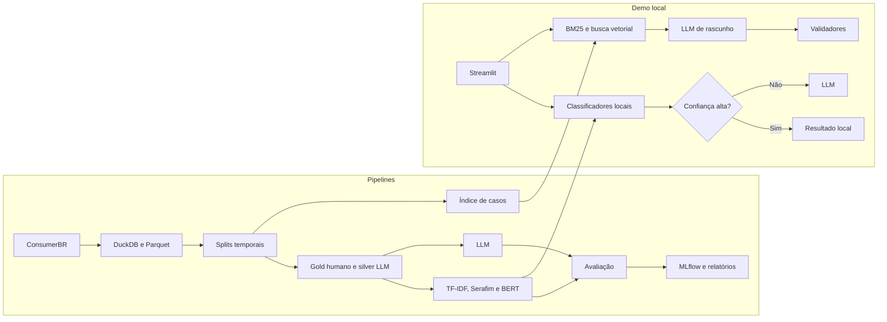

# customer-feedback-ai

Classificação de reclamações em português brasileiro e sugestão de respostas, comparando TF-IDF, BERT e LLM em qualidade, custo e latência.

> **Status: em planejamento.** O repositório ainda não contém resultados medidos. Métricas e demo serão preenchidas conforme os marcos forem concluídos.
> 
> **Projeto de portfólio:** roda localmente para demonstrar ML e IA aplicada. Não foi feito para produção, por isso não tem login, API, banco de dados ou deploy.

## O problema

Classificar reclamações parece um caso óbvio para LLMs. Mas pagar por uma chamada a cada texto pode ser desnecessário se um modelo simples já resolver boa parte dos casos.

O projeto parte de uma pergunta prática:

**Quando vale usar TF-IDF, quando vale treinar um BERT e quando vale pagar por um LLM?**

## O que o projeto faz

Dada uma reclamação, o `customer-feedback-ai`:

1. **Classifica tema e urgência** com modelos de complexidade crescente.
2. **Compara qualidade, custo e latência** de cada abordagem.
3. **Usa uma cascata** que chama o LLM apenas nos casos incertos ou sensíveis.
4. **Sugere uma resposta** com base em casos parecidos, usando busca híbrida.
5. **Valida o rascunho** contra invenção de valores, prazos, protocolos e dados pessoais.
6. **Abstém-se** quando não houver evidência suficiente.

O sistema não envia respostas. Toda sugestão precisa de revisão humana.

## Diferenciais técnicos

- **Comparação justa:** todos os modelos recebem o mesmo texto e são avaliados nos mesmos dados.
- **Custo completo:** considera inferência, rótulos, treino e ponto de equilíbrio.
- **Avaliação realista:** usa split temporal e testa empresas não vistas no treino.
- **Referência humana:** a qualidade é medida contra um gold set anotado por uma pessoa.
- **RAG sem respostas padronizadas:** templates são excluídos do índice e viram baseline.
- **Evals em CI:** mudanças em prompts e validadores passam por testes de regressão.
- **Texto não confiável:** reclamações são tratadas como dados, com testes de prompt injection.

## Arquitetura



O projeto é uma biblioteca Python com pipelines em lote e uma interface local em Streamlit.

## Dados

O projeto usa o [**ConsumerBR**](https://zenodo.org/records/18022568), corpus de reclamações e respostas de empresas em português brasileiro, publicado pela UFMG a partir de dados públicos do Consumidor.gov.br.

Segundo o artigo:

- são cerca de 3,15 milhões de registros;
- o período vai de maio de 2021 a abril de 2025;
- os textos foram anonimizados;
- há status, nota e indicação de resposta padronizada;
- o uso é restrito a fins de pesquisa.

Os dados abertos oficiais do Consumidor.gov.br trazem metadados, mas não o texto das reclamações. Por isso, não servem como fonte para esta comparação.

**O corpus não acompanha este repositório.** Para usá-lo, leia e aceite a licença no [Zenodo](https://doi.org/10.5281/zenodo.18022568). Este projeto não tenta reidentificar pessoas nem redistribuir os dados.

## Abordagem

### Classificação

O corpus não tem rótulos de tema nem de urgência. Por isso, o projeto cria:

- um **gold set** anotado manualmente, usado para avaliação;
- rótulos **silver** gerados por LLM em maior volume, usados para treinar os modelos locais.

| Etapa | Modelo                                     |
| ----- | ------------------------------------------ |
| B0    | Classe majoritária                         |
| B1    | Regras com palavras-chave                  |
| C1    | TF-IDF com regressão logística             |
| C2    | Embeddings Serafim com regressão logística |
| C3    | BERTimbau com fine-tuning                  |
| C4    | LLM de menor custo                         |
| C5    | LLM de maior custo                         |
| C6    | Cascata                                    |

### Cascata

Um classificador local atende aos casos de alta confiança. Casos incertos, ou com sinais de urgência, seguem para o LLM. O principal resultado do projeto é uma curva de custo por 1.000 reclamações contra qualidade.

### Sugestão de resposta

A recuperação combina BM25 e busca vetorial com Reciprocal Rank Fusion. O índice prioriza respostas personalizadas e bem avaliadas. O rascunho usa placeholders quando faltam dados e cita os casos usados.

## Avaliação

| Dimensão      | Métricas                                                                        |
| ------------- | ------------------------------------------------------------------------------- |
| Qualidade     | Macro-F1 de tema, F1 por classe, macro-F1 de urgência e recall de urgência alta |
| Custo         | Custo por 1.000 reclamações, custo inicial e ponto de equilíbrio                |
| Latência      | p50 e p95 por reclamação                                                        |
| Generalização | Resultado em período futuro e em empresas não vistas                            |
| Recuperação   | Recall@5 e nDCG@5                                                               |
| Rascunho      | Fatos inventados, citações válidas, abstenção e avaliação humana                |

## Resultados

<!-- RESULTS:START -->

Os resultados ainda não foram medidos. Esta seção será atualizada automaticamente por `make report`.

| Experimento            | Macro-F1 | Custo por 1.000 | Latência p95 |
| ---------------------- | -------- | --------------- | ------------ |
| B0: Classe majoritária | Pendente | Pendente        | Pendente     |
| B1: Regras             | Pendente | Pendente        | Pendente     |
| C1: TF-IDF             | Pendente | Pendente        | Pendente     |
| C2: Serafim            | Pendente | Pendente        | Pendente     |
| C3: BERTimbau          | Pendente | Pendente        | Pendente     |
| C4: LLM de menor custo | Pendente | Pendente        | Pendente     |
| C5: LLM de maior custo | Pendente | Pendente        | Pendente     |
| C6: Cascata            | Pendente | Pendente        | Pendente     |

<!-- RESULTS:END -->

## Principais trade-offs

| Decisão                      | Ganho                        | Custo                                           |
| ---------------------------- | ---------------------------- | ----------------------------------------------- |
| Sem API, banco ou containers | Foco em ML e medições        | Não demonstra serving, tema de outros projetos  |
| Cascata em vez de LLM puro   | Menor custo potencial        | Thresholds para calibrar                        |
| Split temporal               | Avaliação mais realista      | Métricas tendem a ser menores                   |
| Rótulos silver via LLM       | Mais dados de treino         | Modelos locais podem imitar erros do LLM        |
| Rótulo único de tema         | Anotação e avaliação viáveis | Perde nuance em reclamações com vários assuntos |
| Busca em memória             | Implementação simples        | Não escala como um banco vetorial               |
| Inferência em CPU            | Execução simples             | Pode desfavorecer modelos maiores               |

As decisões do projeto ficam em [`docs/decisions.md`](docs/decisions.md).

## Stack

- **Linguagem e qualidade:** Python 3.12, uv, Ruff, mypy, pytest.
- **Dados:** DuckDB, Parquet.
- **ML:** scikit-learn, PyTorch, Transformers, Sentence Transformers.
- **Modelos de linguagem:** BERTimbau, Serafim e LLM configurável.
- **Busca:** bm25s, NumPy.
- **Experimentos e interface:** MLflow local, Streamlit.
- **Automação:** Makefile, GitHub Actions.

## Como executar

Os comandos abaixo são o fluxo planejado e estarão disponíveis conforme o roadmap avançar.

```bash
git clone <url-do-repositorio>
cd customer-feedback-ai

cp .env.example .env
make setup
make test
```

Depois de obter o ConsumerBR e colocar o CSV em `data/raw/`:

```bash
make data
make splits
make annotate
make label-silver CONFIRM_COST=1
make train-local
make eval-dev
make build-index
make eval-retrieval
make eval-final
make report
make demo
```

`make label-silver`, `make eval-dev` e `make eval-final` usam uma API paga de LLM. Revise a estimativa de custo antes de executá-los.

## Estrutura

```text
configs/   configurações versionadas
data/      dados locais, fora do Git
docs/      status, decisões, data card e model card
evals/     datasets, suítes e respostas gravadas
prompts/   prompts versionados
reports/   métricas e figuras
src/       pipelines, modelos, busca, LLM e validadores
tests/     testes unitários e fixtures sintéticas
ui/        demo e ferramenta de anotação
```

## Roadmap

- [ ] **M0:** Fundação e validação da licença
- [ ] **M1:** Dados e taxonomia
- [ ] **M2:** Rótulos
- [ ] **M3:** Comparação de modelos
- [ ] **M4:** Cascata
- [ ] **M5:** Sugestão de resposta
- [ ] **M6:** Avaliação final e publicação

O plano técnico completo está em [`AGENTS.md`](AGENTS.md).

## Limitações

- O corpus representa uma única plataforma e pode não refletir outros canais.
- O gold set é pequeno, então os resultados devem ser lidos com seus intervalos de confiança.
- Com um único anotador, os rótulos refletem a interpretação de uma pessoa.
- Modelos treinados com rótulos de LLM tendem a imitar esse LLM.
- O projeto não oferece aconselhamento jurídico.
- Os resultados não comprovam desempenho em produção.

## Uso responsável

- Mantenha uma pessoa revisando toda resposta sugerida.
- Não insira dados pessoais na demo.
- Respeite a licença e as restrições do corpus.


## Licença

A licença do código será definida antes da publicação. Os dados do ConsumerBR seguem a licença própria e não fazem parte deste repositório.
